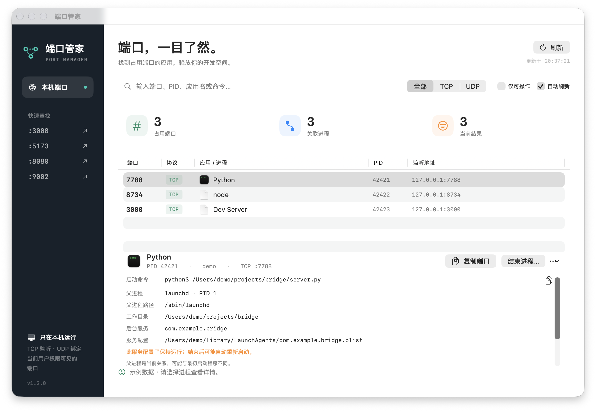

# Port Manager

English | [简体中文](README.md)

A macOS menu bar utility to find processes using local ports and stop them after confirmation.



> The screenshot uses example data.

## Install

1. Download `PortManager-1.2.0-mac-arm64.dmg` from [Releases](https://github.com/TpCBB/port-manager/releases).
2. Open the disk image and drag Port Manager to Applications.
3. Open the app. If macOS blocks it, first verify its source and follow the prompt in System Settings → Privacy & Security.

Requires **Apple Silicon and macOS 13 or later**. This build is ad-hoc signed, not Developer ID signed or notarized. Intel Mac, Windows and Linux are not supported.

## Use

1. Search for a port, PID or application name.
2. Select a row to inspect the process, command, working directory, current parent and any matching current-user background service.
3. Select “结束进程” and confirm to stop the process. This stops the entire process and can affect its other ports.
4. Closing the main window leaves the app in the menu bar, where you can search, stop a process, reopen the window or quit.

The interface is currently in Chinese. Fields may be unavailable because of permissions or process state. A parent can change, and a missing service match does not rule out another supervisor. Services configured to keep running may restart. Data is processed locally and not uploaded. Commands may contain sensitive parameters; review them before sharing.

## Build

Requires Xcode Command Line Tools:

```sh
./scripts/test.sh
./scripts/build.sh
open dist/端口管家.app
```

## License

[MIT](LICENSE)
