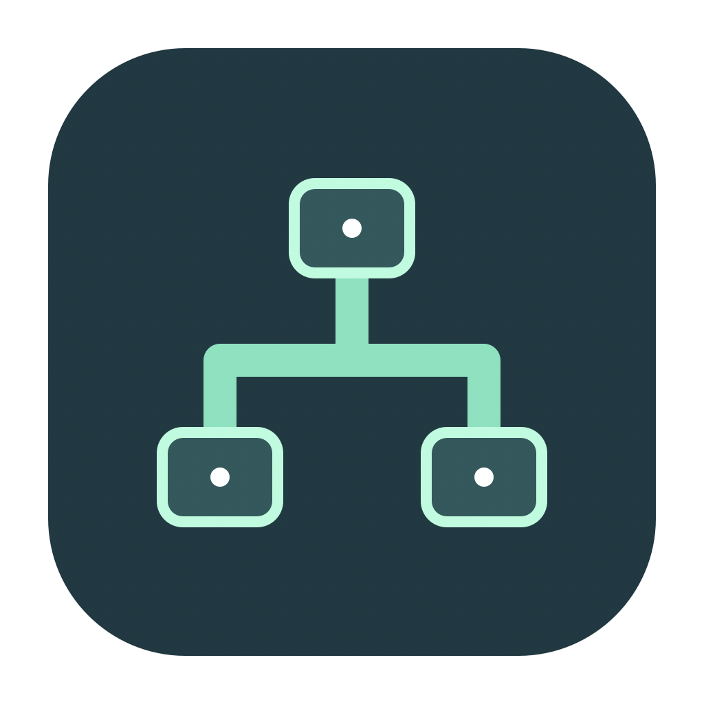
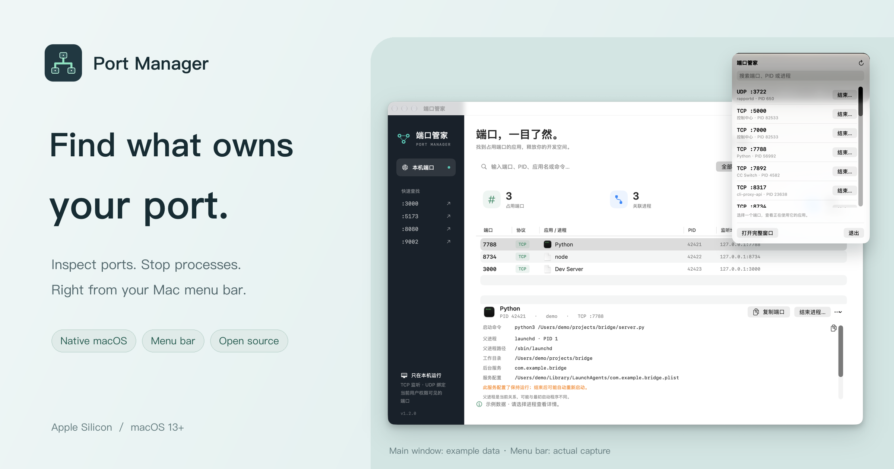
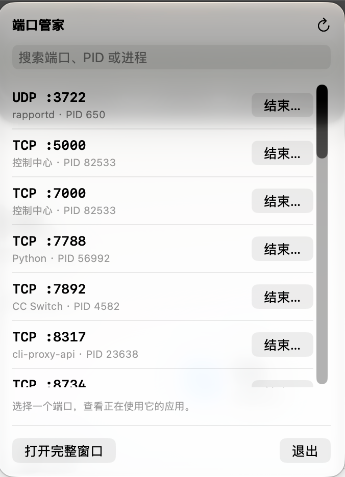

<div align="center">
  
  <h1>Port Manager</h1>
  <p><strong>Find what is using your port.</strong></p>
  <p>A native macOS menu bar utility to inspect ports and stop their processes.</p>

[](https://github.com/TpCBB/port-manager/actions/workflows/ci.yml)
[](https://github.com/TpCBB/port-manager/releases)
[](https://github.com/TpCBB/port-manager/releases)
[](https://github.com/TpCBB/port-manager/releases)
[](LICENSE)

  <p><a href="https://github.com/TpCBB/port-manager/releases/tag/v1.2.1"><strong>Download for macOS ↗</strong></a> · <a href="#features">Features</a> · <a href="CHANGELOG.md">Changelog</a></p>
  <p><a href="README.md">简体中文</a> · English</p>

  <a href="https://github.com/TpCBB/port-manager/releases/tag/v1.2.1"></a>
</div>

A development server fails to start because an old process still owns the port. Port Manager puts the port, app, PID and command in one place, so you can check what it is before stopping it. Keep it in the menu bar for the next time it happens.

## Features

- **Ports at a glance** — TCP listeners and UDP bindings, protocol filters and automatic refresh. IPv4 and IPv6 addresses for the same process and port are merged.
- **Find the owner** — Search by port, PID, app, command or listening address, with shortcuts for common development ports.
- **Inspect process origins** — Executable, command, working directory, current parent and any matching current-user background service, including keep-alive properties.
- **Stop after confirmation** — Normal and forced termination, a list of affected ports, identity checks before signaling and a fresh scan afterward.
- **Ready in the menu bar** — Close the main window and keep searching, stopping processes or reopening the window from the panel.
- **Native, free and open source** — SwiftUI + AppKit, with no extra runtime. Port and process information stays on your Mac.

<details>
<summary><strong>Main window and menu bar screenshots</strong></summary>

### Main window


The main window uses example data and shows v1.2.0.

### Menu bar



The menu bar screenshot shows the actual interface. Ports, process names and PIDs reflect the local machine at the time of capture.

</details>

## Requirements

**Apple Silicon · macOS 13 (Ventura) or later.** The interface is currently in Simplified Chinese. Intel Mac, Windows and Linux are not supported.

## Install

1. Download **`PortManager-1.2.1-mac-arm64.dmg`** from the [v1.2.1 release](https://github.com/TpCBB/port-manager/releases/tag/v1.2.1).
2. Open the disk image and **drag 端口管家.app to Applications**.
3. Open the app. This preview is ad-hoc signed, without Developer ID signing or Apple notarization. If macOS blocks it, verify the download source and follow the prompt in **System Settings → Privacy & Security**.

A `PortManager.zip` is also available. Extract it and move the app to Applications. Both downloads have a matching `.sha256` file.

<details>
<summary>Verify a download</summary>

Place the archive and its `.sha256` file in the same directory, then run there:

```sh
shasum -a 256 -c PortManager-1.2.1-mac-arm64.dmg.sha256
# Or verify the ZIP
shasum -a 256 -c PortManager.zip.sha256
```

An `OK` result means the download matches the published checksum.

</details>

## Usage

1. **Find** — Enter a port, PID or app name, or filter by TCP / UDP.
2. **Inspect** — Select a row to check the command, working directory, current parent and any matching background service.
3. **Release** — Select “结束进程”, review the affected ports and confirm. If normal termination does not stop it, you can choose force termination.
4. **Keep it handy** — Close the main window and use the menu bar icon. Choose “退出” to quit completely.

Stopping a process affects all its services and may release several ports. A supervised process may restart. Fields depend on permissions and process state; a parent can change, and a missing service match does not rule out another supervisor. Commands may contain sensitive parameters; review them before sharing.

## Build from source

Requires Apple Silicon and Xcode Command Line Tools:

```sh
git clone https://github.com/TpCBB/port-manager.git
cd port-manager
./scripts/test.sh
./scripts/build.sh
open dist/端口管家.app
```

Build the DMG, ZIP and checksums:

```sh
./scripts/package-macos.sh
```

## Development & releases

- **CI** — Tests, builds and verifies the app signature on pushes to `main` and pull requests.
- **Versioning** — `VERSION` is the source of the app version. See [CHANGELOG.md](CHANGELOG.md).
- **Tag-based releases** — Pushing a `v*` tag checks the version, tests and packages the app, then publishes a preview release with a DMG, ZIP and their SHA-256 checksums.
- **Release notes** — Version, date and grouped changes. See the [release process](docs/RELEASING.md).

## License

[MIT](LICENSE)
