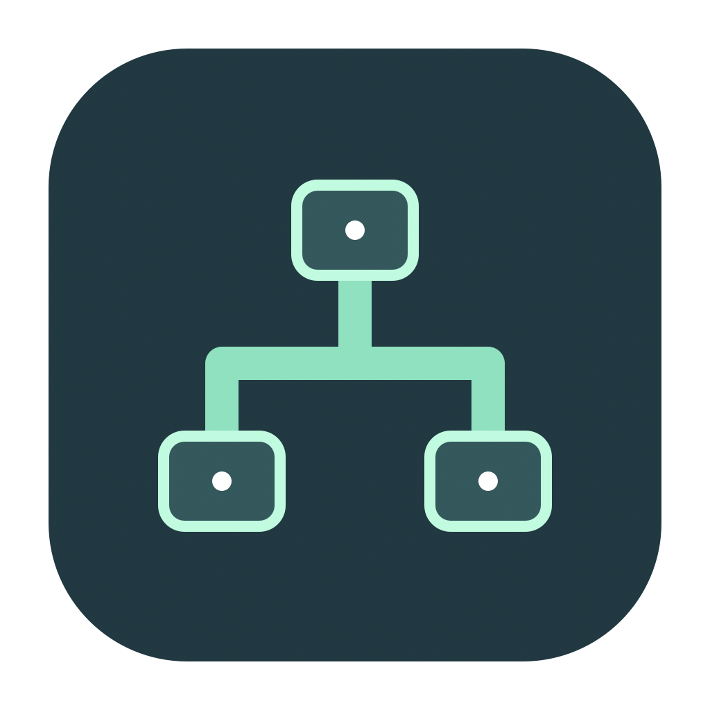
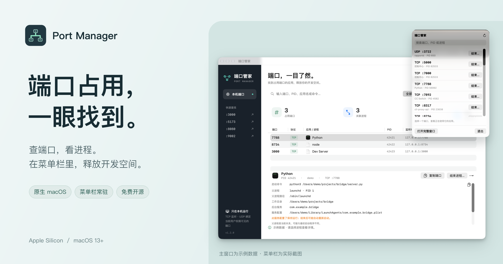
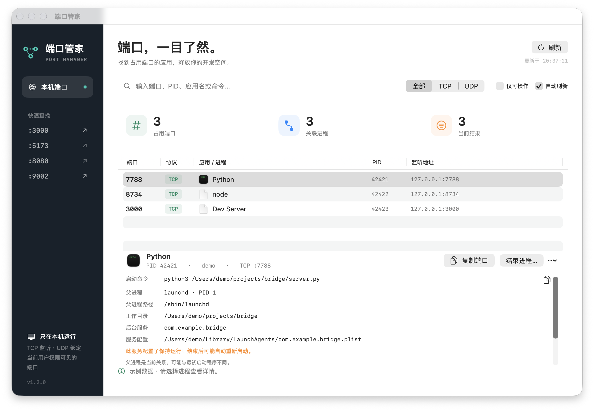
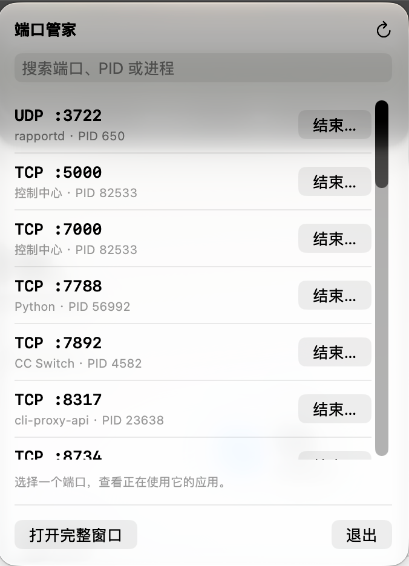

<div align="center">
  
  <h1>端口管家</h1>
  <p><strong>端口占用，一眼找到。</strong></p>
  <p>在 macOS 菜单栏里查端口、看进程、释放开发空间。</p>

[](https://github.com/TpCBB/port-manager/actions/workflows/ci.yml)
[](https://github.com/TpCBB/port-manager/releases)
[](https://github.com/TpCBB/port-manager/releases)
[](https://github.com/TpCBB/port-manager/releases)
[](LICENSE)

  <p><a href="https://github.com/TpCBB/port-manager/releases/tag/v1.2.1"><strong>下载 macOS 预览版 ↗</strong></a> · <a href="https://port-manager.hsc28yo.workers.dev/">官网 ↗</a> · <a href="#功能">功能介绍</a> · <a href="CHANGELOG.md">更新记录</a></p>
  <p>简体中文 · <a href="README.en.md">English</a></p>

  <a href="https://github.com/TpCBB/port-manager/releases/tag/v1.2.1"></a>
</div>

开发服务启动失败，才发现端口还被上一次的进程占着？端口管家把端口、应用、PID 和启动命令放在一起。先看清是谁，再确认是否结束；平时收在菜单栏，需要时随手打开。

## 功能

- **端口一目了然** — 查看 TCP 监听和 UDP 绑定，按协议筛选，自动刷新；合并同一进程、同一端口的 IPv4 / IPv6 地址。
- **快速找到占用者** — 按端口、PID、应用名、命令或监听地址搜索，常用开发端口可快捷查找。
- **看清进程来源** — 查看可执行文件、启动命令、工作目录、当前父进程，以及可匹配的当前用户后台服务和保活属性。
- **确认后结束进程** — 支持正常结束和强制结束；确认框列出关联端口，操作前重新核对进程身份，操作后重新扫描。
- **菜单栏随手用** — 关闭主窗口后继续驻留，可直接搜索、结束进程、恢复窗口或退出。
- **原生、免费、开源** — SwiftUI + AppKit，无额外运行时；端口和进程信息只在本机处理。

<details>
<summary><strong>查看主窗口和菜单栏截图</strong></summary>

### 主窗口



主窗口截图使用示例数据，版本为 v1.2.0。

### 菜单栏



菜单栏截图为实际界面。端口、进程名和 PID 仅代表截图时的本机状态。

</details>

## 系统要求

**Apple Silicon Mac · macOS 13 (Ventura) 或更高版本。** 界面目前为简体中文。暂不支持 Intel Mac、Windows 和 Linux。

## 安装

1. 从 [v1.2.1 发布页](https://github.com/TpCBB/port-manager/releases/tag/v1.2.1) 下载 **`PortManager-1.2.1-mac-arm64.dmg`**。
2. 打开安装包，将 **「端口管家」拖入「应用程序」**。
3. 打开应用。当前预览版使用临时签名，尚未经过 Apple Developer ID 签名或公证；如果 macOS 阻止打开，请先确认下载来源，再按「系统设置 → 隐私与安全性」中的提示允许打开。

也提供 `PortManager.zip`，解压后将「端口管家.app」移入「应用程序」。两个安装文件均有对应的 `.sha256` 校验文件。

<details>
<summary>校验下载文件</summary>

将安装文件和对应的 `.sha256` 文件放在同一目录，在该目录运行：

```sh
shasum -a 256 -c PortManager-1.2.1-mac-arm64.dmg.sha256
# 或校验 ZIP
shasum -a 256 -c PortManager.zip.sha256
```

输出 `OK` 表示文件内容与发布时的校验值一致。

</details>

## 使用

1. **查找** — 输入端口号、PID 或应用名，也可以按 TCP / UDP 筛选。
2. **确认来源** — 选择记录，查看启动命令、工作目录、当前父进程和可匹配的后台服务。
3. **释放端口** — 点击「结束进程」，阅读关联端口和影响说明后确认。普通结束未退出时，可再选择强制结束。
4. **收进菜单栏** — 关闭主窗口，点击顶部图标继续使用；需要完全退出时选择「退出」。

结束的是整个进程，可能同时影响其他端口。服务配置了保持运行时，结束后可能自动重启。部分信息受系统权限或进程状态影响；父进程可能变化，未匹配到后台服务不代表没有其他管理器。启动命令也可能含敏感参数，分享前请检查。

## 从源码构建

需要 Apple Silicon Mac 和 Xcode Command Line Tools：

```sh
git clone https://github.com/TpCBB/port-manager.git
cd port-manager
./scripts/test.sh
./scripts/build.sh
open dist/端口管家.app
```

生成 DMG、ZIP 和校验文件：

```sh
./scripts/package-macos.sh
```

## 开发与发布

官网源码位于 [`website/`](website/README.md)，使用 Astro + GSAP，支持本地预览和静态构建。

- **CI** — 每次推送到 `main` 和提交 PR 时运行测试、构建并校验应用签名。
- **版本管理** — `VERSION` 为构建版本来源；更新记录见 [CHANGELOG.md](CHANGELOG.md)。
- **标签发布** — 推送 `v*` 标签后，自动检查版本、运行测试、打包并发布预览版，附上 DMG、ZIP 和各自的 SHA-256 校验文件。
- **发布说明** — 使用版本、日期和分组更新条目，完整步骤见 [发布流程](docs/RELEASING.md)。

## 许可证

[MIT](LICENSE)
